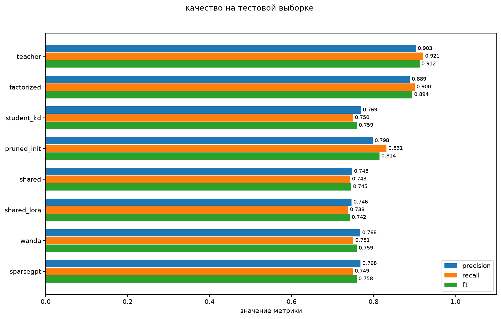
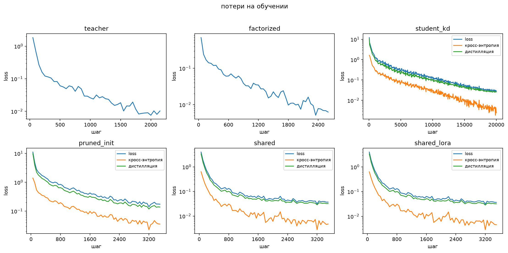
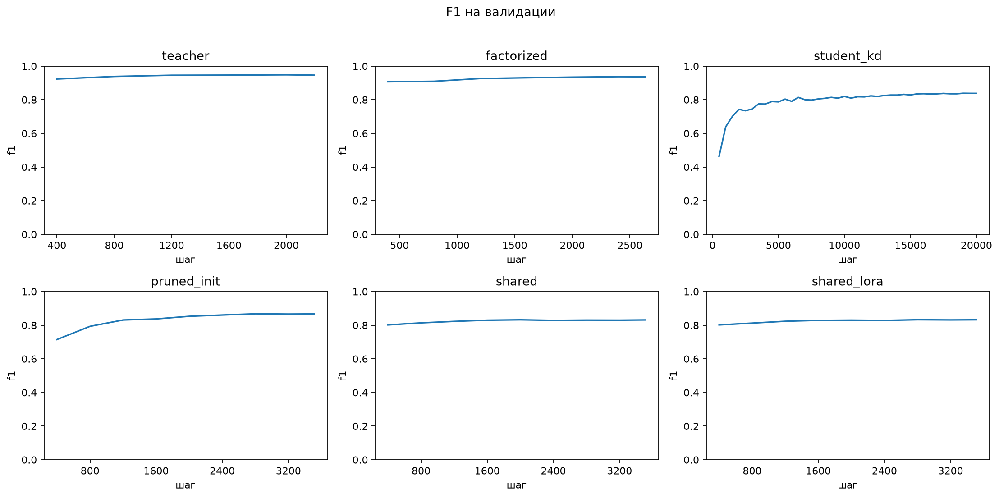
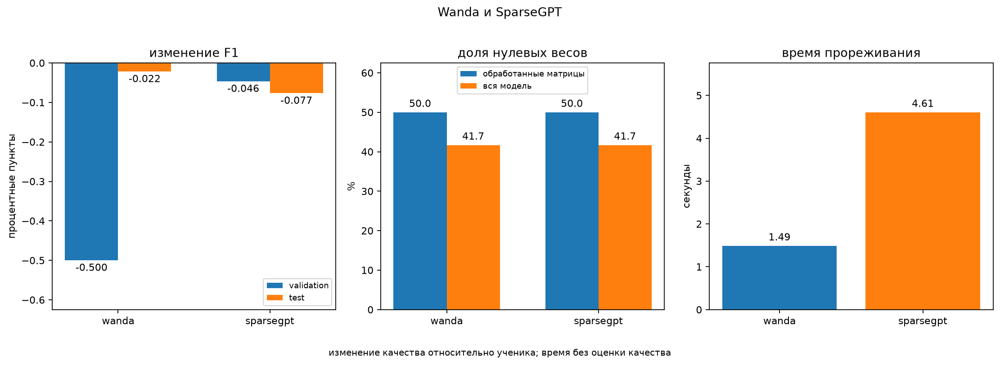
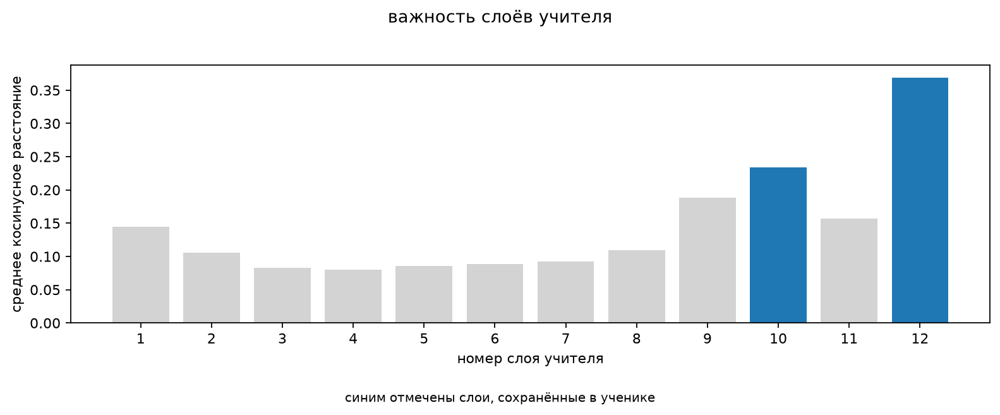
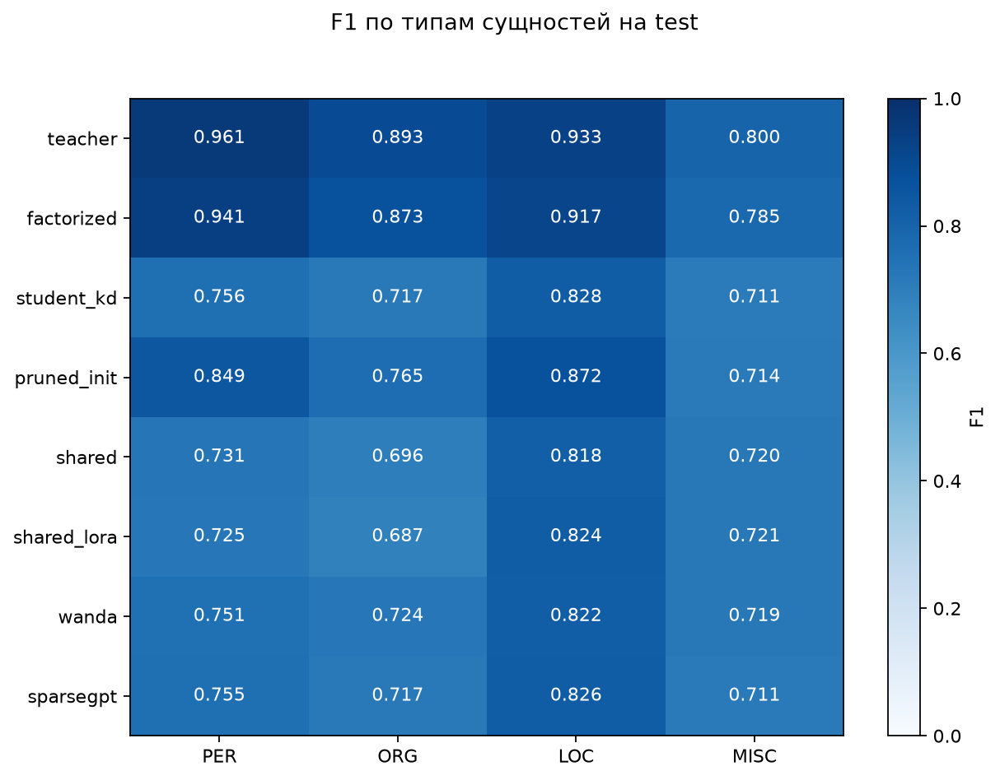
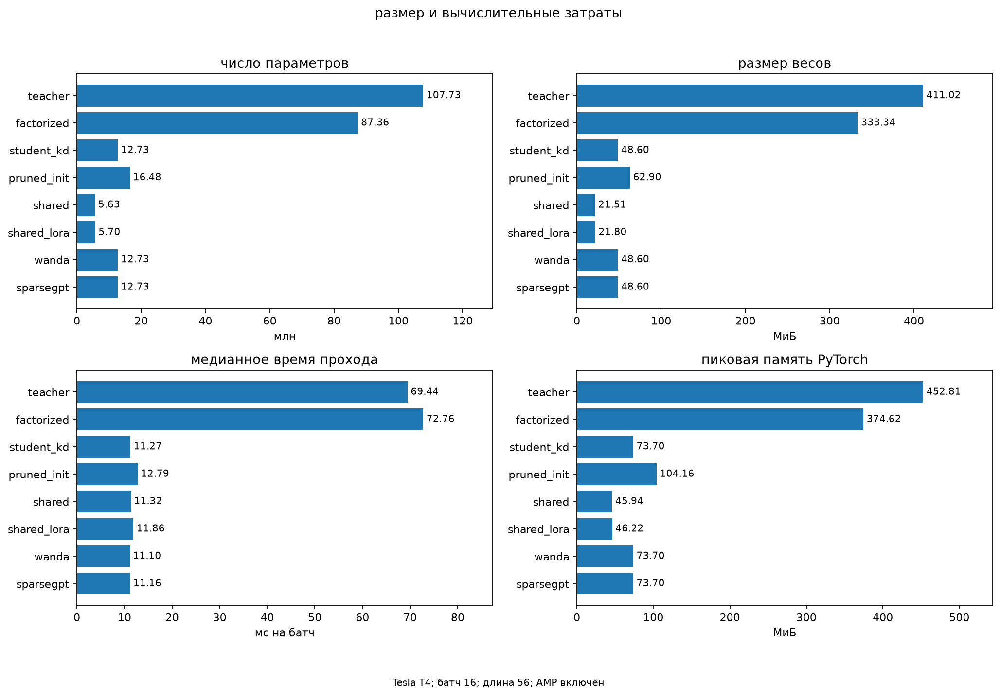
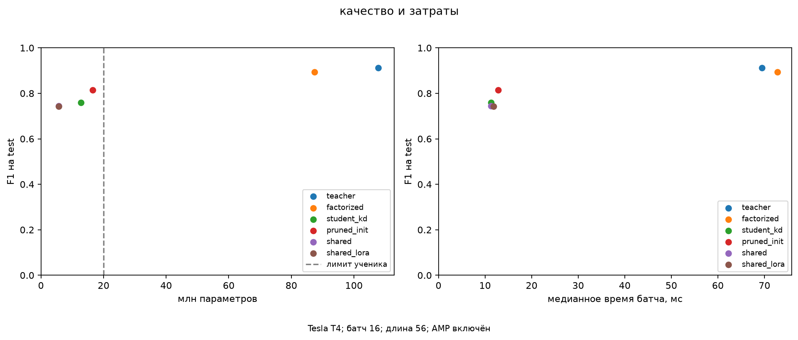
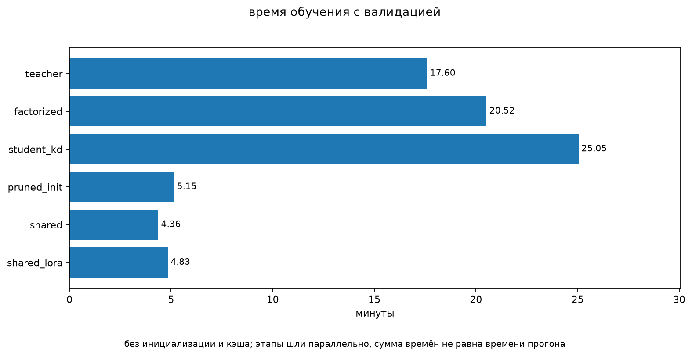

в домашке нужно было уменьшить BERT для NER и сравнить несколько способов уменьшения/дистиляции, получив ученика с числом параметров <20млн. и посмотреть сколько чего теряется при сжатии

https://www.kaggle.com/code/mikhailklalalamo1/hw3-distillation

код моделей находится в `src/models.py`, подготовка и оценка данных в `src/data.py` и `src/evaluation.py`, loss и обучение в `src/objectives.py` и `src/training.py`, прунинг в `src/pruning.py`, сборка экспериментов и команды запуска находятся в `src/experiments.py` и `src/cli.py`. `src/__init__.py` оставлен как файл пакета для запуска команд через `python -m src.cli`

лучший результат среди компактных моделей получился у `pruned_init`: 0.8144 f1 при 16.48 млн параметров, самый маленький вариант — `shared`, у него 5.63 млн параметров и 0.7452 f1, а исходный учитель получил 0.9120 f1, поэтому потеря качества при сильном сжатии всё же заметная

(я кстати забыл что дедлайн мягкий был два дня назад из-за терок с военкоматом))))) поставьте пж как будто сдал в дедл молю и так настроения нет повестка пришла)


помимо обязательных шеринг весов, шеринг с lora, wanda, sparsegpt и инициализация ученика удалением слоёв учителя, дистилляцию промежуточных представлений и minilmv2 скипнул 

все числа ниже взяты из сохранённых json в `runs`. итоговый test оценивался для лучших весов по validation, параметры и качество моделей получились такими

| модель | параметры, млн | лучший f1 на validation | f1 на test |
| --- | ---: | ---: | ---: |
| teacher | 107.73 | 0.9478 | 0.9120 |
| factorized | 87.36 | 0.9367 | 0.8943 |
| student_kd | 12.73 | 0.8381 | 0.7593 |
| pruned_init | 16.48 | 0.8676 | 0.8144 |
| shared | 5.63 | 0.8318 | 0.7452 |
| shared_lora | 5.70 | 0.8322 | 0.7420 |
| wanda | 12.73 | 0.8331 | 0.7590 |
| sparsegpt | 12.73 | 0.8377 | 0.7585 |

для wanda и sparsegpt в столбце validation указана оценка после однократного прунинга, без выбора среди нескольких шагов обучения



в задании 1 использовал `ashaba1in/conll2003` и токенизатор `bert-base-cased`, в train 14041 предложение, в validation 3250, в test 3453, с сохранением регистра как просили, максимальная длина фрагмента — 128 токенов вместе со специальными токенами. если предложение не помещается, оно делится по границам слов, слова при этом не обрезаются и не теряются, после таких махинаций получилось после разбиения 14042, 3254 и 3455 фрагментов в train/val/test

выравнивание меток реализовано в [src/data.py](src/data.py). первый подтокен получает исходную метку слова, а следующие части слова с меткой `B-X` получают `I-X`, при обучении loss считается по всем размеченным подтокенам.

при оценке брал предсказание первого подтокена каждого слова и собирал исходные предложения обратно. f1 считается через `seqeval` с микроусреднением по сущностям, как в задании. это проверяется в [src/evaluation.py](src/evaluation.py)

для всех обучаемых моделей использовал adamw, weight decay 0.01, линейный warmup на первых 10% шагов и затем линейное уменьшение `lr`. seed равен 42, градиенты ограничиваются нормой 1.0, на gpu включён amp, обычный эффективный размер батча — 32 - либо один батч из 32 примеров, либо два батча по 16 с накоплением градиента

| эксперимент | максимальный learning rate | батч x накопление | выполнено шагов | шаг лучших весов |
| --- | ---: | ---: | ---: | ---: |
| teacher | 3e-5 | 16 x 2 | 2195 | 2000 |
| factorized | 3e-5 | 16 x 2 | 2634 | 2400 |
| student_kd | 5e-4 | 32 x 1 | 20000 | 19000 |
| pruned_init | 5e-5 | 16 x 2 | 3512 | 2800 |
| shared | 1e-4 | 32 x 1 | 3512 | 2000 |
| shared_lora | 1e-4 | 32 x 1 | 3512 | 2800 |

validation проверяется каждые 400 шагов, у `student_kd` каждые 500, и дополнительно в конце обучения, и во всех шести запусках обучение дошло до заданного бюджета, ранняя остановка не сработала. конфиги лежат в `configs`, (крутая тема, подсмотрел на курсе звука) фактически использованные настройки вместе со значениями по умолчанию — в `runs/<модель>/run.json`





на графиках loss шкала по вертикали логарифмическая, а число шагов у моделей разное. у учителя и факторизованной модели показана только кросс-энтропия. у остальных моделей к ней добавляется ошибка дистилляции, поэтому напрямую сравнивать высоту кривых разных экспериментов нельзя

у ученика loss уменьшается примерно с 12.05 на первой записанной точке до 0.0287 на последней. при этом f1 на validation к концу уже почти не растёт. лучшие веса получились на шаге 19000, а не на последнем шаге. похожее плато видно у моделей с общими весами, поэтому для test используются сохранённые лучшие веса, а не просто итоговые

в задании 2 дообучил `bert-base-cased` с новой головой на 9 классов - у учителя 12 слоёв, hidden size 768 и 12 голов внимания,обучение шло 5 эпох, итоговый f1 на test — 0.91199

в задании 3 заменил матрицу эмбеддингов произведением двух матриц ранга 64, это класс `FactorizedEmbedding` в [src/models.py](src/models.py). исходная матрица имеет размер 28996x768 и содержит 22268928 параметров. после факторизации остаются матрицы 28996x64 и 64x768, всего 1904896 параметров

инициализация делается приближённым svd по эмбеддингам дообученного учителя. сингулярные значения распределяются между двумя матрицами через квадратный корень. fwsvd здесь не использовал. затем модель дообучается 6 эпох с обычной кросс-энтропией

число параметров всей модели снизилось со 107.73 до 87.36млн, а f1 — с 0.9120 до 0.8943, то есть на 1.77 процентного пункта, порог 0.87 при ранге 64 выполнен, кстати одной факторизации недостаточно для лимита 20 млн -  это отдельный эксперимент из задания 3, а компактный ученик строится дальше

в задании 4 ученик инициализируется случайно, включая эмбеддинги, encoder и классификатор. у него 6 слоёв, hidden size 384, 6 голов внимания, размер промежуточного слоя 1536 и ранг эмбеддингов 64. всего 12728713 параметров

дистилляция реализована в [src/objectives.py](src/objectives.py). используется сумма жёсткой и мягкой ошибки:

```text
loss = cross_entropy(student_logits, labels)
       + temperature² x kl(softmax(teacher_logits / temperature)
                            || softmax(student_logits / temperature))
```

температура равна 3, вес мягкой ошибки равен 1. в `KLDivLoss(reduction="batchmean")` передаются логарифмы вероятностей ученика и вероятности учителя. перед вычислением ошибки остаются только позиции с меткой, поэтому усреднение происходит по размеченным токенам. множитель temperature² возвращает масштаб градиента после деления логитов на температуру

учитель работает в режиме eval без градиентов. его логиты один раз сохраняются только для train в float16, а потом читаются из кэша по индексам фрагментов. это позволяет не делать прямой проход большого bert на каждом шаге обучения ученика. код кэша находится в [src/cache.py](src/cache.py), цикл обучения — в [src/training.py](src/training.py)

ученик выполнил все 20000 шагов и получил 0.75926 f1 на test, оба требования задания выполнены - параметров меньше 20 млн, f1 выше 0.7. относительно учителя параметров стало в 8.46 раза меньше, но f1 снизился на 15.27 процентного пункта. отдельного ученика с обучением только по разметке в этом запуске нет, поэтому вклад самой мягкой ошибки отдельно не измерял

для шеринга взял обученного `student_kd` и объединил его шесть слоёв в две группы, слои с индексами 0, 2, 4 используют один набор параметров, слои 1, 3, 5 — другой, начальные веса каждой группы получены усреднением соответствующих слоёв ученика, глубина вычислений остаётся равной шести, но уникальные параметры повторно используются

после 8 эпох дообучения с дистилляцией модель `shared` получила 0.74518 f1 при 5.63 млн параметров - это на 55.8% меньше параметров, чем у основного ученика, при потере 1.41 процентного пункта f1, подсчёт параметров учитывает общие веса только один раз

в варианте `shared_lora` к той же усреднённой основе добавлены отдельные адаптеры ранга 8 для проекций query и value на каждой из шести глубин. начальная поправка адаптера равна нулю. общая основа и адаптеры обучаются вместе, основа не заморожена. реализация тоже находится в [src/models.py](src/models.py)

адаптеры добавили 73728 параметров, на validation результат чуть выше, чем у обычного шеринга - 0.8322 против 0.8318. на test получилось наоборот- 0.7420 против 0.7452.

в этом эксперименте добавление lora не дало улучшения итогового качества, запуск был с одним seed, поэтому такую небольшую разницу не считаю доказательством того, что lora вообще не подходит для этой задачи

для wanda и sparsegpt использовал лучшие веса `student_kd`, оба метода применяются один раз после обучения, без дальнейшего дообучения, калибровочные данные — одинаковые 256 случайно выбранных фрагментов train с seed 42. test для калибровки не используется

в wanda важность веса определяется как его абсолютное значение, умноженное на корень из среднего квадрата соответствующего входа, в каждой строке матрицы обнуляется половина весов с наименьшей важностью

в sparsegpt собирается матрица `x.T @ x / n`, которая описывает связи между входными признаками, к ней добавляется регуляризация, затем через разложение холецкого получается информация об обратной матрице^ обработка идёт блоками по 128 входных признаков. веса выбираются для удаления с учётом этой информации, а ошибка обнуления переносится на оставшиеся столбцы, начальная регуляризация — 0.01 от среднего диагонального элемента

оба метода реализованы в [src/pruning.py](src/pruning.py). статистики для следующего encoder-слоя собираются уже с учётом изменений предыдущих слоёв. всего обработано 36 линейных матриц: проекции внимания и feed-forward в шести слоях, эмбеддинги, смещения, нормализации и классификатор сохраняются



| вариант | f1 на validation | f1 на test | изменение test f1, п.п. | время прунинга, с |
| --- | ---: | ---: | ---: | ---: |
| исходный student_kd | 0.838119 | 0.759258 | 0 | — |
| wanda | 0.833122 | 0.759040 | -0.0217 | 1.49 |
| sparsegpt | 0.837655 | 0.758491 | -0.0767 | 4.61 |

оба метода почти сохранили качество ученика. sparsegpt лучше сохранил f1 на validation, а на test немного выше оказался wanda. на основании одного прогона уверенного преимущества одного метода здесь нет, время в таблице включает калибровочные проходы при прунинге, но не загрузку модели и оценку качества до и после него

в обработанных матрицах ровно 50% нулей, во всей модели около 41.70%. это разные величины, поскольку часть параметров не прореживается. при этом матрицы продолжают храниться и вычисляться в плотном формате. число параметров остаётся 12.73 млн, файл весов занимает около 48.60мб, а время прохода почти не меняется. в этой реализации прунинг показал, что много весов можно обнулить без заметной потери f1, но практического уменьшения плотного файла или ускорения вычислений он не дал

для инициализации ученика прунингом оценил важность слоёв учителя по среднему косинусному расстоянию между входом и выходом слоя. использовал 256 калибровочных фрагментов из train и только позиции слов, затем оставил два слоя с наибольшими оценками, сохранив их исходный порядок



выбрались слои 10 и 12 при нумерации с единицы. в `run.json` это индексы 9 и 11. у нового ученика осталось два слоя ширины 768, эмбеддинги факторизованы до ранга 64, позиционные эмбеддинги и классификатор перенесены из учителя, после этого модель дообучается 8 эпох с той же дистилляцией выходов

`pruned_init` получил 0.81436 f1 при 16.48 млн параметров. это на 5.51 процентного пункта выше, чем у случайно инициализированного `student_kd`, и лучший результат среди проверенных моделей до 20 млн параметров. однако здесь одновременно отличаются и инициализация, и архитектура: два широких слоя вместо шести узких, а параметров больше поэтому весь выигрыш нельзя приписать только способу инициализации, выбор слоёв по косинусному расстоянию это эвристика, перебор других пар слоёв не проводился

промежуточные представления в этом месте нужны только для оценки важности слоёв. отдельной ошибки дистилляции скрытых слоёв в обучении нет



по типам сущностей потери распределились неравномерно. у учителя лучше всего распознаются люди: f1 для per равен 0.961, для loc 0.933, для org 0.893, для misc 0.800. у основного ученика per падает до 0.756, а org до 0.717. самый большой абсолютный разрыв с учителем здесь у per. у компактных моделей loc обычно распознаётся лучше остальных типов

инициализация из учителя заметно помогает per: 0.849 вместо 0.756, а также org - 0.765 вместо 0.717. для misc изменение небольшое: 0.714 вместо 0.711. у шеринга с lora немного лучше loc и misc, чем у обычного шеринга, но хуже per и org, и общего выигрыша по f1 не получилось

посмотрел также конкретные ошибки из `test_errors.json`. например, в предложении с `example_id=4` основной ученик пропускает `Uzbekistan`: вместо `B-LOC` выдаёт `O`. в примере 6 имя `Oleg Shatskiku` размечено как `B-PER I-PER`, а ученик выдаёт `O B-PER`, то есть теряет начало сущности. в примере 23 слово `ROME` получает `B-ORG` вместо `B-LOC`. это примеры трёх разных проблем: пропуск сущности, ошибка границы и ошибка типа

учитель тоже ошибается- в примере 15 слово `Bitar` получает `B-ORG` вместо `B-PER`. поэтому его предсказания не являются безошибочной заменой разметки. в файлах ошибок сохранены только первые 100 предложений с несовпадениями для каждой модели. по ним можно разбирать отдельные случаи, но нельзя оценивать частоты ошибок на всём test, график по типам сущностей, в отличие от этого списка примеров, построен по всему test





у учителя проход занял 69.44 мс, у основного ученика 11.27 мс — примерно в 6.16 раза быстрее в этом замере. размер файла весов снизился с 411.02 до 48.60мб, память с 452.81 до 73.70мб

факторизация уменьшила размер весов до 333.34мб, но ускорения не дала: проход занял 72.76 мс. encoder остался из 12 слоёв, а получение эмбеддингов теперь включает дополнительную проекцию. поэтому уменьшение числа хранимых параметров само по себе не означает уменьшение времени прохода

у шеринга файл весов уменьшился до 21.51 мб, память до 45.94мб, а скорость осталась почти как у ученика - 11.32 мс. это ожидаемо для такой реализации, потому что выполняются всё те же шесть проходов через encoder-блоки, добавление lora немного увеличило время до 11.86 мс

у `pruned_init` размер весов 62.90мб, память 104.16мб, время прохода 12.79 мс, он немного дороже основного ученика по этим измерениям, но даёт более высокий f1 если выбирать по качеству при лимите 20 млн, я бы оставил его, если важнее минимальный размер файла то `shared` выглядит более подходящим вариантом

